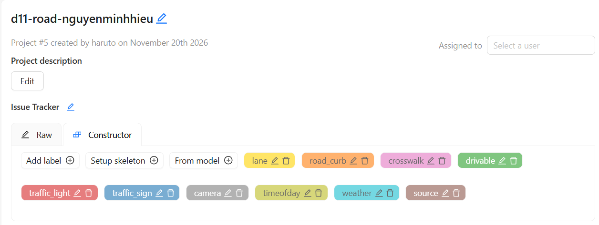
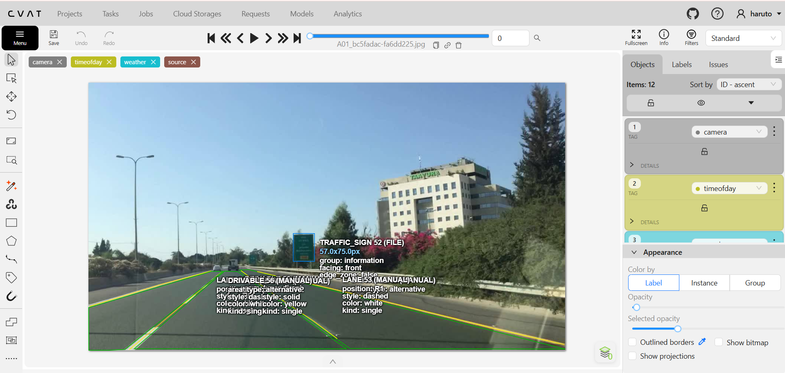
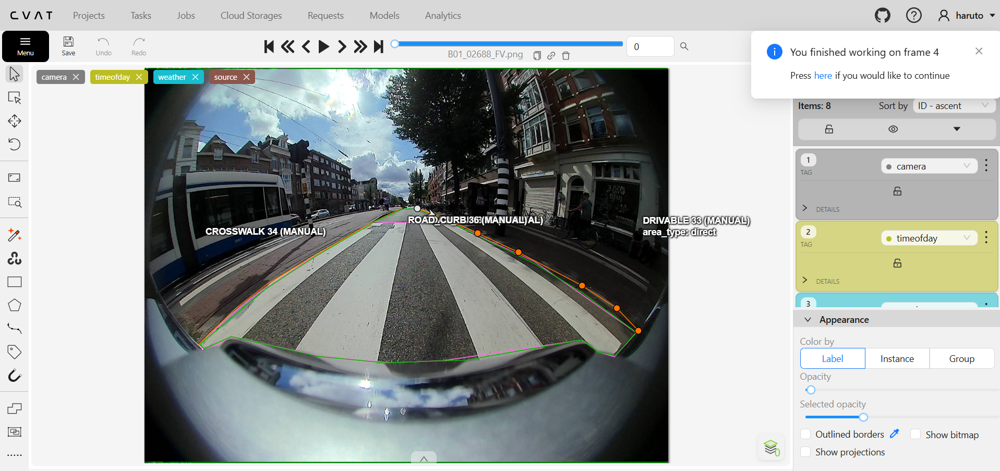
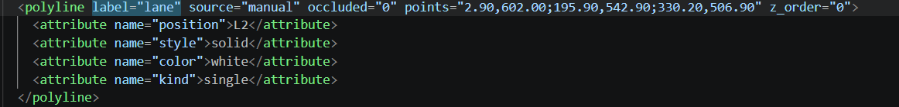

# Báo cáo cá nhân — Ngày 11
Họ tên: Nguyễn Minh Hiếu            Mã học viên:  2A202603169
Phiên bản CVAT (Help → About):  2.81.0 
Guideline: Road v1.0    Lần nộp (`revision` trong manifest):  revision=1 theo lệnh road_check lint --manifest mới nhất
Thời điểm export (ngày giờ trên CVAT): Front 2026-11-21 09:47:56.451748+00:00; Fisheye 2026-11-21 09:58:41.792459+00:00   Số lần nộp lại sau Rework:  1

## 1. Kiểm project
| Mục | Đúng như guideline Road v1.0? | Ghi chú |
| --- | --- | --- |
| 6 label, đúng kiểu |	Đạt đối chiếu schema XML  |lane, road_curb: polyline; crosswalk, drivable: polygon; traffic_light, traffic_sign: rectangle.  |
| Thuộc tính và giá trị |Đủ thuộc tính/giá trị ở 20 ảnh bắt buộc trong kiểm tra XML  |  |
| 4 tag ảnh | Đủ trên 20 ảnh bắt buộc |  |
Cách kết thúc polyline trên bản CVAT này:  
Cách đặt tag ảnh trên bản CVAT này:  

## 2. Số lượng đã gán
| Task | Ảnh gán | lane | road_curb | crosswalk | drivable | traffic_light | traffic_sign |
|---|---:|---:|---:|---:|---:|---:|---:|
| front | 12 | 29 | 13 | 4 | 21 | 14 | 10 |
| front-extra (đã làm 0/4) | 0 | 0 | 0 | 0 | 0 | 0 | 0 |
| fisheye | 8 | 7 | 16 | 9 | 10 | 2 | 1 |
| fisheye-extra (đã làm 0/4) | 0 | 0 | 0 | 0 | 0 | 0 | 0 |
| **Tổng đã gán** | **20** | 36 | 29 | 13 | 31 | 16 | 11 |

## 3. Bảng ca khó
| Ảnh | Nhãn | Phân vân giữa | Đã chọn trong ZIP hiện tại | Lý do / hướng kiểm chứng |
|---|---|---|---|---|
| A01 | `lane`, `drivable` | L1/R1/R2 và phân vùng direct/alternative | Có L2, R1, L1, R2 và ba polygon drivable | Cần so lại chính xác ranh giới làn ego ở ảnh xa, không tự suy diễn từ polygon. |
| A04 | `lane` | Ranh giới L1/R2 và vạch vàng kép | Hai lane R2 và hai lane L1 | Cần đối chiếu trên ảnh để tránh một vạch bị tách thành các position giống nhau; phân biệt `kind=double`. |
| A05 | `lane` | Không thấy vạch L1/R1 hay bị mờ | Không gán lane | Nếu vạch thật sự không nhìn thấy, chỉ miễn cảnh báo QC1-02 sau khi coach xác nhận. |
| A06 | `lane`, `crosswalk` | Zebra và đường phân làn dưới kết cấu cầu | Có crosswalk, không có lane | Gán crosswalk thành polygon; việc không có lane phải được xem trên pixel/coach xác nhận. |
| A09 | `lane` | 3 đường cùng vị trí L1 | Cả 3 lane mang `L1` | Cần xác định lại ranh giới làn xe dựa trên ảnh, không thể có kết luận chỉ từ tên thuộc tính. |
| A10 | `weather` | Overcast vs rain | `rain` | Road v1.0 cho phép rain khi mặt đường ướt rõ do mưa. |
| A11 | `lane` | Hai line L1 ở cảnh tối | Hai lane mang `L1` | Cần kiểm xem cùng một vạch bị tách hay sai quy chiếu làn. |
| B03 | `lane` | Vẽ đường từ gần đến xa với camera rear | Có R1/L2/L1; hai polyline có y điểm cuối lớn hơn y đầu | Kiểm chiều theo khoảng cách thật trên fisheye rear, không chỉ suy từ y. |
| B05 | `lane` | Position với camera trái | Hai lane mang `other` | Đã sửa lỗi position từ `R1` (bản 3) thành `other` (bản 4); giữ nguyên hai polyline; cần rà lại chiều vẽ và hình học. |
| B09–B12 | File export | Ảnh bonus chưa làm | Bốn image entries trống | Kiểm khi export; nếu nộp bonus phải hoàn thành tags và shapes tương ứng. |

## 4. Phiếu QC 1 nhận được
Bạn kiểm lô của tôi: Bùi Anh Dũng  Quyết định nhận được:  Hold
| Mã lỗi | Số lỗi xác nhận | Mức | Đồng ý? | Trạng thái sửa trong bản (4) |
|---|---:|---|---|---|
| QC1-01 tag camera | 0 | nặng | Đúng trong sáu ảnh kiểm | Không có lỗi phát hiện |
| QC1-02 đủ L1/R1 | 0 xác nhận | nặng nếu thấy vạch bị bỏ sót | Cần xem ngoại lệ với coach | Chưa xác minh A05/A06/A07 |
| QC1-03 position | **3** (A04 #8, #9; A09 #4) | **nặng** | Có bằng chứng XML + overlay, cần sửa | **đã sửa** |
| QC1-04 tâm/chiều/dừng | **2** (B03 #3, #4) | chính | Có bằng chứng chiều điểm trong XML + ảnh | **đã sửa** |
| QC1-05 đứt/che | 0 xác nhận | chính | Chưa phát hiện lỗi trong mẫu | Chưa có lỗi xác nhận |
| QC1-06 style/color/kind | 0 tính riêng | chính | Có liên quan lỗi A04 #8 đã tính QC1-03 | Chưa sửa A04 |
| QC1-07 vùng lái | **1** (B05 #8) | chính | Overlay cho thấy polygon tiến vào thân xe | **đã sửa** |
| QC1-08 đèn/màu | 0 xác nhận | nặng/chính | Chưa phát hiện lỗi trong mẫu | Chưa có lỗi xác nhận |
| QC1-09 facing/type/group | 0 xác nhận | chính | Chưa phát hiện lỗi trong mẫu | Chưa có lỗi xác nhận |
| QC1-10 hình in/biển | 0 xác nhận | chính | Chưa phát hiện lỗi trong mẫu | Chưa có lỗi xác nhận |
| QC1-11 fisheye | 0 tính riêng | chính | Vấn đề B03/B05 đã tính trong các mã khác | Cần sửa B03/B05 |
| QC1-12 file | 0 lỗi mở ZIP trong lần lint mới | nhẹ/nặng | 2 ZIP đọc được; bonus B09–B12 trống | Log lint mới xác nhận đã xuất manifest, xem mục 5 |

## 5. Kiểm file export
| File | Mở lại được? | Số shape ảnh 1 (job / file) | Số shape ảnh 2 (job / file) | Tag camera có trong XML? |
|---|---|---|---|---|
| `nguyenminhhieu-front(4).zip` | **ZIP + XML parser đọc được** | A01: **chưa xác nhận trong job / 8** | A02: **chưa xác nhận trong job / 7** | Có, A01–A12 |
| `nguyenminhhieu-fisheye(4).zip` | **ZIP + XML parser đọc được** | B01: **chưa xác nhận trong job / 4** | B02: **chưa xác nhận trong job / 9** | Có, B01–B08; không có trên B09–B12 trống |

## 6. Ảnh chụp màn hình
1. Tab Labels của project.
2. Một ảnh camera trước đã gán đủ (làn, vùng lái, đèn/biển).
3. Một ảnh fisheye đã gán, phóng to đoạn polyline cong.
4. Một đoạn XML có <polyline label="lane">.

## 7. Tự đánh giá
Lỗi bạn mắc nhiều nhất hôm nay (theo mã QC1-xx), và cách tránh ở Ngày 20:  
Nhãn của bạn đi vào model ở đâu? Chọn một lỗi đã sửa và nói nó làm model học sai thế nào:  

## 8. (Tùy chọn, buffer) Từ polyline đến đích row-anchor
| y | 720 | 680 | 640 | 600 | 560 |
| --- | ---: | ---: | ---: | ---: | ---: |
| x của chúng tôi |  |  |  |  |  |
| x của bạn kia |  |  |  |  |  |

Trả lời 3 câu:

1. Năm số x đó chính là đích mà một model row-anchor học cho vạch này. Nếu bạn dừng polyline sớm 40 px, hàng nào đổi thành "không có làn"?
2. So với bạn được kiểm (cùng ảnh): ở hàng 720 và hàng 560, hai bạn lệch nhau bao nhiêu pixel? Lệch ở hàng nào ảnh hưởng LKA nhiều hơn (slide 25)?
3. Nếu polyline vẽ từ xa về gần (ngược quy tắc 2), cách tính trên có đổi không? Script nào sẽ gặp khó?
